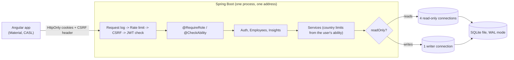

# salary-management

Web software for an HR team to manage the pay of 10,000 employees across 10 countries and to answer
"how do we pay people?" without Excel.

## What it does

- **Employees:** search, filter, sort and page through 10,000 people; add, edit and delete them.
- **Pay insights:** headcount, total, average, median, lowest and highest pay by country, department or job title,
  all compared in US dollars at fixed, documented exchange rates.
- **Sign-in and roles:** four roles, from "can do everything" down to "can only see and change one country".
  The server enforces every rule; the screens only hide what you cannot use.
- **Safe by default:** HttpOnly cookie sessions with automatic refresh, CSRF protection, per-IP rate limiting.

| Role | Employees | Insights |
|---|---|---|
| `SUPERADMIN` | everything | everything |
| `HR_MANAGER` | all countries: view, add, edit, delete | read |
| `HR_VIEWER` | all countries: read-only | read |
| `COUNTRY_HR` (regional officer) | their own country: view, add, edit | their own country |

## Stack

| Layer | Choice |
|---|---|
| Backend | Java 21, Spring Boot 4, Spring Security, Spring Data JPA |
| Database | SQLite in WAL mode ([ADR-0003](docs/adr/0003-sqlite-database.md), [ADR-0005](docs/adr/0005-sqlite-access-wal-and-pools.md)), Flyway migrations |
| UI | Angular 22, Angular Material, CASL (permissions) |
| Tests | JUnit 5, AssertJ, Mockito, Spring MockMvc / Vitest, Angular TestBed |

## Set up and run

### 1. Prerequisites

| Tool | Version | Check with |
|---|---|---|
| JDK | 21 or newer | `java -version` |
| Node.js (with npm) | **22.22.3 or newer** | `node --version` |
| Git | any | `git --version` |

No database server, no Docker and no global Maven or Angular install are needed. The Maven wrapper (`mvnw`)
downloads the right Maven by itself on first use.

> Node older than 22.22.3 (for example 20)? The frontend will refuse to start. Install a newer Node, or keep your
> default one and point the scripts at a newer copy: copy `.env.example` to `.env.local` and set `NODE22_HOME` to that
> Node folder. The file is gitignored and only used by this project's scripts.

### 2. Get the code

```bash
git clone https://github.com/USER4247/salary-management.git
cd salary-management
```

### 3. Start everything, with demo data (one command)

```bash
npm run dev:local:seed
```

The first run takes a few minutes (it downloads Maven and the npm packages). It then starts:

- the backend at http://localhost:8080 (health check: http://localhost:8080/actuator/health)
- the frontend at **http://localhost:4200**, which forwards `/api` calls to the backend

and loads the 10,000 demo employees if the database is empty. Press `Ctrl+C` to stop both.

### 4. Sign in

Open http://localhost:4200 and use a demo account (below). Click a name on the sign-in page to fill it in.

### 5. Run the tests (optional)

```bash
npm test
```

### Every command

All commands run from the repository root.

| Command | What it does |
|---|---|
| `npm run dev:local` | Starts backend and frontend together, **without** loading demo data (use it when you already have data) |
| `npm run dev:local:seed` | Same, and loads the 10,000 demo employees **if the employees table is empty** |
| `npm run db:seed` | Fills the database file directly with the demo employees (needs the backend to have started once, so the tables exist). Safe while the backend runs. |
| `npm run db:seed -- --reset` | Replaces existing employees with the demo data again |
| `npm run db:seed -- --count 500` | Loads 500 employees instead of 10,000 |
| `npm run db:seed -- --db path/to/file.db` | Targets another database file |
| `npm run db:seed -- --emit-sql file.sql` | Writes the demo data as SQL instead (used to refresh `backend/src/main/resources/db/seed/employees.sql`) |
| `npm run db:reset` | **Deletes the local database** (and its WAL files) so the next start is completely fresh. Stop the backend first. See "Start fresh" below. |
| `npm test` | Backend and frontend tests |
| `npm run test:backend` | Backend tests only (`./mvnw verify` in `backend/`) |
| `npm run test:frontend` | Frontend tests only |

Running a part on its own:

| Command | What it does |
|---|---|
| `cd backend && ./mvnw spring-boot:run` | Backend only (needs `JWT_SECRET`, 32+ characters, in the environment; `dev:local` makes one for you) |
| `cd backend && ./mvnw package` | Builds the runnable jar in `backend/target` |
| `cd frontend && npm ci && npm start` | Frontend dev server only |
| `cd frontend && npm run build` | Production build of the frontend |
| `docker build -t salary-management .` | Builds the single deployable image (see Deploy) |

### Start fresh

The database is a single file (`backend/salary.db`). It keeps everything, including any employees you added, edited or
deleted while trying the app. To go back to a clean state, or to see the app start the way a reviewer would see it:

```bash
# 1. stop the backend (Ctrl+C in the terminal running npm run dev:local)
npm run db:reset          # deletes the database file
npm run dev:local:seed    # recreates the tables and demo accounts, loads the 10,000 employees
```

Only the local development database is touched, and only data that can be recreated (demo accounts and generated
employees). It cannot affect the Docker image or a hosted copy. If the backend is still running, the command refuses and
tells you to stop it, so it never deletes a database that is in use.

### Settings (environment variables)

The defaults are right for local use. The full list is in [`.env.example`](.env.example); the ones you may meet:

| Variable | Default | Meaning |
|---|---|---|
| `JWT_SECRET` | random per `dev:local` start | Signs the login tokens. Required, 32+ characters, never committed |
| `SEED_EMPLOYEES` | `false` (`true` in Docker) | Load the 10,000 employees on start if the table is empty |
| `SEED_DEMO_USERS` | `true` | Create the demo accounts below |
| `DB_URL` | `jdbc:sqlite:./salary.db` | Which database file |
| `PORT` | `8080` | Backend port |
| `AUTH_COOKIE_SECURE` | `true` (`false` in `dev:local`) | Cookies only over HTTPS |
| `RATE_LIMIT_PER_MINUTE`, `RATE_LIMIT_LOGIN_PER_MINUTE` | 300, 10 | Per-IP limits |

### Troubleshooting

| Problem | Fix |
|---|---|
| `The Angular CLI requires a minimum Node.js version` | Use Node 22.22.3+ (see the note under Prerequisites) |
| Port 8080 or 4200 already in use | Stop the other program; these ports are fixed in `dev:local` |
| `npm run db:seed` says the database or the table does not exist | Start the backend once (`npm run dev:local`), then run it again |
| `npm run db:reset` says the database is in use | The backend is still running: stop it first (`Ctrl+C`), then run the reset again |
| Sign-in page keeps asking after a restart | `dev:local` makes a new secret each start, which ends old sessions: just sign in again |
| `429 Too many requests` | The per-IP rate limit; wait a minute |

### Demo accounts

Password for all of them: `Demo@12345` (assessment build only; turn off with `SEED_DEMO_USERS=false`).

| Account | Role |
|---|---|
| `superadmin@acme.test` | SUPERADMIN |
| `manager@acme.test` | HR_MANAGER |
| `viewer@acme.test` | HR_VIEWER |
| `hr.<country>@acme.test`, e.g. `hr.in@acme.test` | COUNTRY_HR for US, IN, GB, DE, CA, FR, AU, JP, SG or BR |

The sign-in page fills these in with a click.

## How it fits together



- **One address for page and API.** When deployed, Spring serves the built Angular files, which the cookie and
  CSRF design relies on ([ADR-0004](docs/adr/0004-authentication-and-authorization.md),
  [ADR-0006](docs/adr/0006-deployment.md)).
- **Permissions in one place.** `Ability.forRole` defines what each role may do in CASL's model; the same rules are
  sent to the UI. A regional officer's country limit is applied inside the database query, so other countries'
  data is never loaded.
- **Reads never wait for writes.** Details in [ADR-0005](docs/adr/0005-sqlite-access-wal-and-pools.md).

## Deploy

The `Dockerfile` builds both apps into one image; `render.yaml` describes the service for Render.
Full steps, settings and the honest caveats are in [ADR-0006](docs/adr/0006-deployment.md).

```bash
docker build -t salary-management .
docker run -p 8080:8080 -e JWT_SECRET="at-least-32-random-characters-here" -e AUTH_COOKIE_SECURE=false salary-management
```

## Documentation

| | |
|---|---|
| [Requirements](docs/requirements/requirements.md) | goal, scope, what was left out and why |
| [API reference](docs/api.md) | every endpoint, request and response shapes (DTOs), real examples, errors |
| [Database](docs/database.md) | tables, columns, rules, relationships, migrations |
| [Decisions (ADRs)](docs/adr) | branching, secrets, SQLite, auth, database access, deployment |
| [Tradeoffs](docs/tradeoffs.md) | the choices that could reasonably have gone the other way |
| [Performance](docs/performance.md) | measured response times on 10,000 rows |
| [How AI was used](docs/ai/workflow.md) | workflow, prompts, and where the human changed direction |
| [Demo script](docs/demo-script.md) | a 5-minute walkthrough for the video |

## Repository layout

- `backend/` Spring Boot service (`auth`, `employee`, `insights`, `db`, `common` packages)
- `frontend/` Angular app
- `scripts/` developer tools: `dev-local`, `seed-employees`
- `docs/` requirements, ADRs and the notes above

## Workflow

- Trunk-based: short-lived branches named `type/short-description`, merged to `main` via PR using merge commits
  ([ADR-0001](docs/adr/0001-trunk-based-development.md)).
- Commits follow [Conventional Commits](https://www.conventionalcommits.org/); each feature carries its own tests, and
  CI runs the backend and frontend suites on every PR.
- Secrets are never committed ([ADR-0002](docs/adr/0002-configuration-and-secrets.md)).
