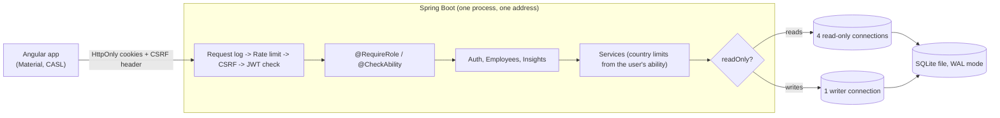

# salary-management

Web software for an HR team to manage the pay of 10,000 employees across 10 countries and to answer
"how do we pay people?" without Excel.

## What it does

- **Employees:** search, filter, sort and page through 10,000 people; add, edit and delete them.
- **Pay insights:** headcount, total, average, median, lowest and highest pay by country, department or job title,
  all compared in US dollars at fixed, documented exchange rates.
- **Sign-in and roles:** four roles, from "can do everything" down to "can only see and change one country".
  The server enforces every rule; the screens only hide what you cannot use.
- **Safe by default:** HttpOnly cookie sessions with automatic refresh, CSRF protection, per-IP rate limiting.

| Role | Employees | Insights |
|---|---|---|
| `SUPERADMIN` | everything | everything |
| `HR_MANAGER` | all countries: view, add, edit, delete | read |
| `HR_VIEWER` | all countries: read-only | read |
| `COUNTRY_HR` (regional officer) | their own country: view, add, edit | their own country |

## Stack

| Layer | Choice |
|---|---|
| Backend | Java 21, Spring Boot 4, Spring Security, Spring Data JPA |
| Database | SQLite in WAL mode ([ADR-0003](docs/adr/0003-sqlite-database.md), [ADR-0005](docs/adr/0005-sqlite-access-wal-and-pools.md)), Flyway migrations |
| UI | Angular 22, Angular Material, CASL (permissions) |
| Tests | JUnit 5, AssertJ, Mockito, Spring MockMvc / Vitest, Angular TestBed |

## Run it

Prerequisites: JDK 21+ and Node 22.22.3+. No database server and no Docker needed.

```bash
npm run dev:local     # backend on :8080 and frontend on :4200 together (Ctrl+C stops both)
npm run db:seed       # 10,000 realistic employees (run once, after the first start)
npm test              # all backend and frontend tests
```

Then open http://localhost:4200 and sign in. If your default Node is older than 22.22.3, copy `.env.example` to
`.env.local` and set `NODE22_HOME` to a newer Node folder (gitignored).

### Demo accounts

Password for all of them: `Demo@12345` (assessment build only; turn off with `SEED_DEMO_USERS=false`).

| Account | Role |
|---|---|
| `superadmin@acme.test` | SUPERADMIN |
| `manager@acme.test` | HR_MANAGER |
| `viewer@acme.test` | HR_VIEWER |
| `hr.<country>@acme.test`, e.g. `hr.in@acme.test` | COUNTRY_HR for US, IN, GB, DE, CA, FR, AU, JP, SG or BR |

The sign-in page fills these in with a click.

## How it fits together



- **One address for page and API.** When deployed, Spring serves the built Angular files, which the cookie and
  CSRF design relies on ([ADR-0004](docs/adr/0004-authentication-and-authorization.md),
  [ADR-0006](docs/adr/0006-deployment.md)).
- **Permissions in one place.** `Ability.forRole` defines what each role may do in CASL's model; the same rules are
  sent to the UI. A regional officer's country limit is applied inside the database query, so other countries'
  data is never loaded.
- **Reads never wait for writes.** Details in [ADR-0005](docs/adr/0005-sqlite-access-wal-and-pools.md).

## Deploy

The `Dockerfile` builds both apps into one image; `render.yaml` describes the service for Render.
Full steps, settings and the honest caveats are in [ADR-0006](docs/adr/0006-deployment.md).

```bash
docker build -t salary-management .
docker run -p 8080:8080 -e JWT_SECRET="at-least-32-random-characters-here" -e AUTH_COOKIE_SECURE=false salary-management
```

## Documentation

| | |
|---|---|
| [Requirements](docs/requirements/requirements.md) | goal, scope, what was left out and why |
| [Decisions (ADRs)](docs/adr) | branching, secrets, SQLite, auth, database access, deployment |
| [Tradeoffs](docs/tradeoffs.md) | the choices that could reasonably have gone the other way |
| [Performance](docs/performance.md) | measured response times on 10,000 rows |
| [How AI was used](docs/ai/workflow.md) | workflow, prompts, and where the human changed direction |
| [Demo script](docs/demo-script.md) | a 5-minute walkthrough for the video |

## Repository layout

- `backend/` Spring Boot service (`auth`, `employee`, `insights`, `db`, `common` packages)
- `frontend/` Angular app
- `scripts/` developer tools: `dev-local`, `seed-employees`
- `docs/` requirements, ADRs and the notes above

## Workflow

- Trunk-based: short-lived branches named `type/short-description`, merged to `main` via PR using merge commits
  ([ADR-0001](docs/adr/0001-trunk-based-development.md)).
- Commits follow [Conventional Commits](https://www.conventionalcommits.org/); each feature carries its own tests, and
  CI runs the backend and frontend suites on every PR.
- Secrets are never committed ([ADR-0002](docs/adr/0002-configuration-and-secrets.md)).
