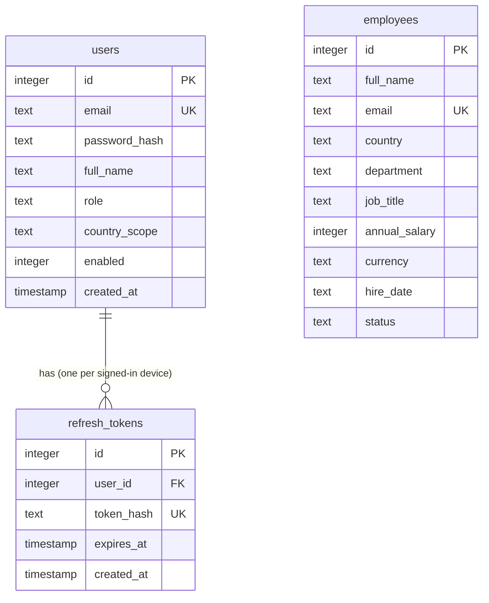

# Database

SQLite, one file (`backend/salary.db` in development, `/data/salary.db` in the Docker image), in WAL mode.
The schema is owned by Flyway migrations in `backend/src/main/resources/db/migration`; Hibernate never changes it.
Why SQLite and how connections are used: [ADR-0003](adr/0003-sqlite-database.md), [ADR-0005](adr/0005-sqlite-access-wal-and-pools.md).

`employees` is deliberately separate from `users`: employees are the people whose pay is managed (10,000 of them);
users are the few people who sign in to manage it. There is no foreign key between them.

## Tables

### `users` (people who can sign in)

| Column | Type | Rules | Notes |
|---|---|---|---|
| `id` | INTEGER | primary key, auto-increment | |
| `email` | TEXT | required, unique | compared case-insensitively by the app |
| `password_hash` | TEXT | required | BCrypt hash, never the password |
| `full_name` | TEXT | required | |
| `role` | TEXT | required, one of `SUPERADMIN`, `HR_MANAGER`, `HR_VIEWER`, `COUNTRY_HR` | what each role may do: `Ability.forRole` |
| `country_scope` | TEXT | required when `role = COUNTRY_HR` (CHECK) | ISO country code the officer is limited to, e.g. `IN` |
| `enabled` | INTEGER | default 1 | 0 blocks sign-in and refresh |
| `created_at` | TIMESTAMP | required | epoch milliseconds, UTC (see "Dates") |

### `refresh_tokens` (the "stay signed in" tokens)

| Column | Type | Rules | Notes |
|---|---|---|---|
| `id` | INTEGER | primary key | |
| `user_id` | INTEGER | foreign key to `users(id)`, indexed | |
| `token_hash` | TEXT | required, unique | SHA-256 of the token; the token itself is never stored |
| `expires_at` | TIMESTAMP | required | 7 days after issue by default |
| `created_at` | TIMESTAMP | required | |

A token works once: using it deletes the row and creates a new one (rotation). Logout deletes the row.

### `employees` (the people whose pay is managed)

| Column | Type | Rules | Notes |
|---|---|---|---|
| `id` | INTEGER | primary key, auto-increment | |
| `full_name` | TEXT | required | |
| `email` | TEXT | required, unique | |
| `country` | TEXT | required | ISO 3166-1 alpha-2, e.g. `IN`. Regional officers are limited by this column. |
| `department` | TEXT | required | the demo data has 8 |
| `job_title` | TEXT | required | the demo data has 27 |
| `annual_salary` | INTEGER | required, must be > 0 (CHECK) | whole units of `currency`, so there are no rounding errors |
| `currency` | TEXT | required | ISO 4217, e.g. `INR`. The API only accepts currencies that have an exchange rate. |
| `hire_date` | TEXT | required | ISO date `yyyy-MM-dd` |
| `status` | TEXT | required, one of `ACTIVE`, `ON_LEAVE`, `TERMINATED` (CHECK) | |

There are no indexes on `employees` besides the unique email. They will be added together with measured queries
([performance notes](performance.md)).

## Migrations

| Version | File | What it does |
|---|---|---|
| V1 | `V1__create_auth_tables.sql` | first version of `users` and `refresh_tokens` |
| V2 | `V2__simplify_auth_tables.sql` | rebuilds both: new role names, refresh tokens without families (see [ADR-0004](adr/0004-authentication-and-authorization.md)) |
| V3 | `V3__create_employees.sql` | the `employees` table |

Flyway also keeps its own `flyway_schema_history` table. Never edit a migration that has been applied; add a new one.
A migration applies automatically when the backend starts.

## Dates

- A **moment in time** (`created_at`, `expires_at`) is stored as epoch milliseconds in UTC from the server's clock
  (the SQLite driver's default; not yet pinned explicitly).
- A **calendar date** (`hire_date`) is stored as text `yyyy-MM-dd`: it has no time zone and sorts correctly as text.

## Demo data

- `users`: created at start-up when `SEED_DEMO_USERS=true`: one per role plus a regional officer for each of 10 countries.
- `employees`: 10,000 rows from `npm run db:seed` (development) or loaded on first start when `SEED_EMPLOYEES=true`
  (`db/seed/employees.sql`, generated by the same script). Always the same data.

## Resetting the local database

`npm run db:reset` deletes `backend/salary.db` together with its two WAL companion files (`-wal`, `-shm`). The next
backend start runs the migrations again, so the tables, the demo accounts and, with `npm run dev:local:seed`, the 10,000
employees all come back exactly as on a first run.

Why it exists:
- The database file remembers everything, so after experimenting (adding, editing, deleting employees) there is no other
  way to see the first-run experience, other than deleting the file by hand and remembering which companion files go
  with it.
- Deleting only the main file while SQLite's `-wal` file stays behind can leave a half-database, which is why the
  command removes all three together.

How it stays safe:
- It deletes only a file whose name ends in `.db` (default `backend/salary.db`; another one with `--db path`).
- It deletes the main file first. If the backend is running, the operating system refuses (the file is in use), and the
  command stops there without touching anything else.
- It only affects the local development database. Data in it is generated (demo accounts and seeded employees).
  The Docker image and any hosted copy recreate their data on start and are not touched.

## Looking inside

Any SQLite viewer works (for example DB Browser for SQLite) on `backend/salary.db`, even while the backend runs (WAL mode).
From the command line, with the `sqlite3` tool installed: `sqlite3 backend/salary.db "select country, count(*) from employees group by country"`.
